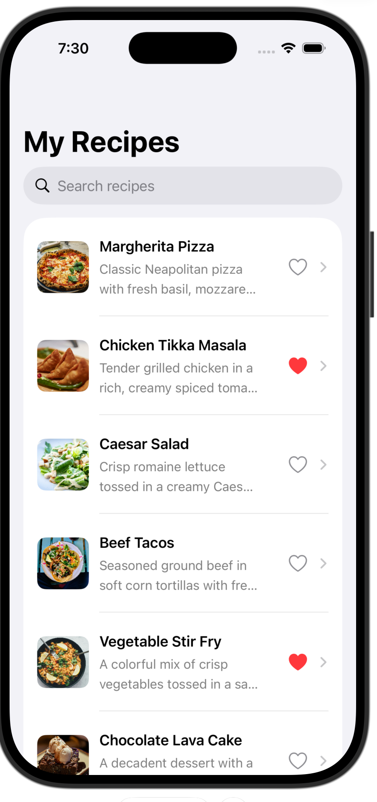

# My Recipes

A clean iOS recipe app built with **SwiftUI**. Browse a collection of recipes, search by name, mark favorites, and tap through to full ingredients and details — all in a native, swipe-smooth interface.

> **Status:** UI showcase. The app ships with a built-in set of sample recipes (not a live backend or API yet).

<p align="center">
  
</p>

---

## Features

- **Recipe list** — browse recipes with name, description, and photo
- **Live search** — filter recipes by name as you type (`.searchable`)
- **Favorites** — tap the heart to mark or unmark a recipe as a favorite
- **Detail view** — tap any recipe to see its full description and ingredient list
- **Remote images** — recipe photos loaded from URLs
- **Native navigation** — built on `NavigationStack` for smooth push/pop flow

## Tech Stack

| Area | Technology |
|---|---|
| Language | Swift |
| UI framework | SwiftUI |
| Navigation | `NavigationStack`, `NavigationLink` |
| State management | `@State` with an `Identifiable` model |
| Search | `.searchable` modifier |
| Images | Remote image loading from URLs |

## Requirements

- Xcode 15 or later
- iOS 16 or later (required by `NavigationStack`)

## Getting Started

1. Clone the repository:
   ```bash
   git clone https://github.com/CaptTauhid5832/<repo-name>.git
   cd <repo-name>
   ```
2. Open the project in Xcode (double-click the `.xcodeproj` file).
3. Choose an iPhone simulator and press **Run** (`⌘R`).

## Project Structure

```
MyRecipes/
├── ContentView.swift      # Recipe list, search bar, and favorite toggling
├── RecipeRowView.swift     # The row shown for each recipe in the list
├── RecipeDetailView.swift  # Full recipe screen: description + ingredients
└── Recipe (model)          # Identifiable struct: name, description, ingredients, image, isFavorite
```

## How It Works

- Each recipe is a `Recipe` struct conforming to `Identifiable`, holding its name, description, ingredient list, image URL, and favorite state.
- `ContentView` keeps the recipes in `@State` and derives `filteredRecipes` from the search text:
  ```swift
  recipes.filter { $0.name.localizedCaseInsensitiveContains(searchText) }
  ```
- Tapping the heart calls `toggleFavorite(for:)`, which flips `isFavorite` on the matching recipe so the UI updates instantly.
- `NavigationLink` pushes a `RecipeDetailView` for the selected recipe.

## Possible Next Steps

- Load recipes from a real API (e.g., Spoonacular or TheMealDB)
- Persist favorites with SwiftData or UserDefaults so they survive relaunch
- Filter view for favorites only
- Step-by-step cooking instructions and serving sizes

## Author

**Capt. L K Tauhidur Rahman (Retd)**
GitHub: [CaptTauhid5832](https://github.com/CaptTauhid5832)
